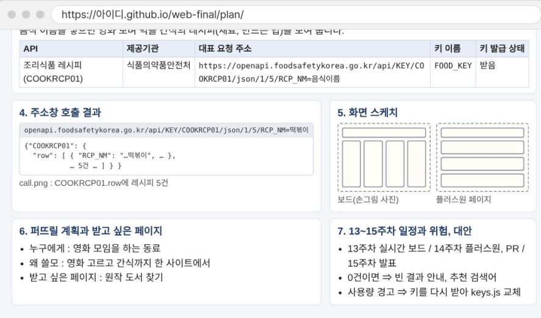
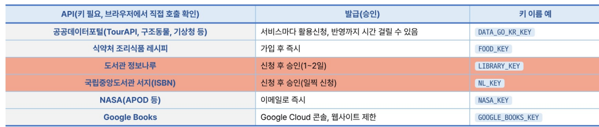

### web-final

# 기말 기말 프로젝트 : 영화 플러스원
- 내 플러스원 페이지는 동료 사이트로 보내기
- 동료 페이지는 받아 담는 개인 중심의 협업 프로젝트

**[사이트 주소]** https://nan041768-ui.github.io/web-final/
   **→ Pages: Deploy from a branch**

**[Repository주소]** https://nan041768-ui.github.io/web-final/plan/

| File 항목 |
| plan/index.html | 기획서 |
|  |  |
|  |  |
|  |  |
|  |  |
|  |  |

# 기획서 plan/index.html
## 일곱 항목
1 이름, GitHub 아이디, 사이트 이름
2 누구를 위한 사이트(한 줄)
   _보드, 박스오피스, 상세에 보여 줄 것_
3 플러스원 페이지: 이름, 한 줄 소개
   _쓰는 API표: 이름, 제공기관, 대표 요청 주소, 키 이름, 키 발급 상태
4 주소창 호출 결과 캡처 1장
5 화면 스케치 2장
   _보드, 플러스원(손그림 사진 가능, figure)_
6 퍼뜨릴 계획과 받고 싶은 페이지
7 13~15주차 일정과 위험, 대안

마감 13주차 수업 시작 전 커밋 LMS에 저장소 주소, 기획서 주소

## API 고르기 & 키 신청

**- 키 선정 기준**
   - 하루 호출 한도가 넉넉한 키 (동료 사이트에서도 내 키로 부름)
   - NASA DEMO_KEY 는 시간당 제한 개인 키
   - 키 없는 API는 보조로만, 카탈로그 밖은 기획서 4항 + 13주차 확인

**- 받은 키를 두는 곳** _코드에서는 getKey("FOOD_KEY")로만 읽음. 무료 교육용 키만_
> pages/내아이디/
> index.html, app.js
> style.css, README.md
> keys.js 내키

         ↓

> 동료 web-final
> pages/내아이디/
> 폴더째 들어감
> keys.js 함께

